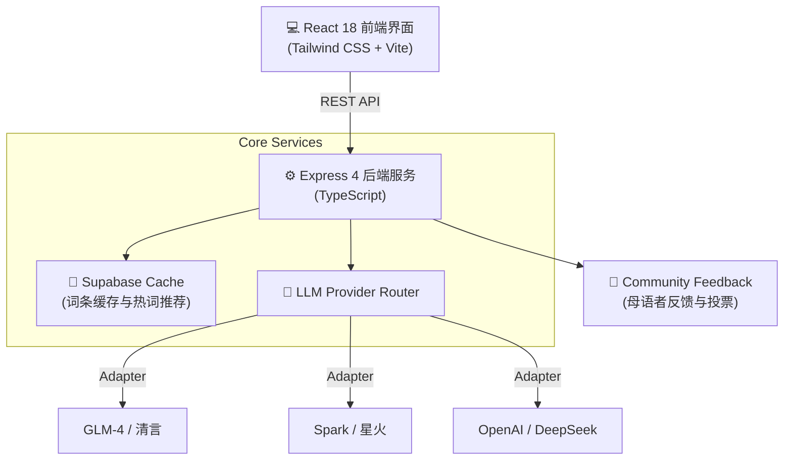

# 🗣️ Xiangyin (乡音) · AI Dialect Translation & Culture Platform

<p align="center">
  <b>An AI-Powered Chinese Dialect Translation & Cultural Exploration Platform</b><br>
  基于 React + Express + Supabase 与多大语言模型路由的中华方言双向翻译与文化探索平台
</p>

<p align="center">
  
  
  
  
  
  
  
</p>

---

## 📖 项目简介 (Overview)

**Xiangyin (乡音)** 是一个旨在保护与传承中华方言多样性的智能化 Web 应用。

项目采用前后端分离架构，前端基于 **React 18 + Tailwind CSS** 提供温润的国风交互界面，后端基于 **Express + TypeScript** 构建了多大语言模型（LLM）适配层。支持方言到普通话的语义识别与反向地道转译，并集成了文化词源科普与去中心化的社区众包修正机制。

---

## 🌟 核心特性 (Key Features)

- **🔄 双向方言翻译与发音标注**：
  - **方言 → 普通话**：自动判定方言语系（如粤语、吴语、闽南语、西南官话等），提取核心语义并保留地方修辞色彩。
  - **普通话 → 方言**：针对选定地域生成地道方言用词，并伴随汉语拼音或国际音标（IPA）发音指引。
- **🤖 多模型智能路由 (Multi-Model Adapter)**：
  - 抽象统一的 LLM Client 接口，原生兼容智谱 GLM、讯飞星火、DeepSeek、OpenAI 等多家 API 供应商。
  - 支持按需配置生成多样性温度（Temperature）与采样惩罚参数。
- **📜 文化语境与词源科普卡片**：
  - 翻译结果自动附带地域历史沿革、典故出处与民俗背景。
  - 引入 Supabase (PostgreSQL) 缓存机制，避免重复解析开销。
- **🤝 社区众包反馈与校验**：
  - 母语者可针对机器翻译提出俚语修正与评价投票，沉淀高质量方言微调数据对。

---

## 🏛️ 系统架构 (Architecture)



---

## 🛠️ 技术栈 (Tech Stack)

| 模块 | 技术选型 | 作用与特性 |
|---|---|---|
| **前端呈现** | React 18, Vite, Tailwind CSS, Lucide | 响应式布局、平滑转场与轻量状态管理 |
| **服务端** | Express 4, Node.js, TypeScript | RESTful API 路由分发与统一异常拦截 |
| **数据持久化** | Supabase (PostgreSQL) | 翻译历史缓存、社区勘误词条与地理信息标注 |
| **模型对接** | Axios, OpenAI-compatible SDKs | 流式响应、重试机制与多供应商密钥轮转 |

---

## 📦 项目结构 (Directory Structure)

```text
dialect-translate/
├── api/                    # Express 后端应用
│   ├── config/             # 数据库连接与模型参数配置
│   ├── services/           # LLM 适配器、地理位置与缓存服务
│   ├── routes/             # API 路由 (/api/translate, /api/feedback)
│   └── server.ts           # 服务入口
├── src/                    # React 前端工程
│   ├── components/         # 翻译输入框、结果展示卡、社区反馈栏
│   ├── hooks/              # API 交互与防抖 Hook
│   └── styles/             # Tailwind 全局样式配置
└── supabase/               # 数据库 Schema 与表结构定义
```

---

## 🚀 快速开始 (Quickstart)

### 1. 环境准备
- Node.js (>= 18.0.0)
- pnpm 或 npm

### 2. 克隆与依赖安装
```bash
git clone https://github.com/Evan-Joseph/dialect-translate.git
cd dialect-translate
pnpm install
```

### 3. 配置环境变量
复制并编辑 `.env`：
```bash
cp .env.example .env
```

配置核心参数：
```env
# 核心大模型配置（根据实际供应商选择）
ZHIPU_API_KEY=your_zhipu_api_key
ZHIPU_ENDPOINT=https://open.bigmodel.cn/api/paas/v4/chat/completions

# 可选：Supabase 数据库（若留空则走内存 Mock 兜底）
SUPABASE_URL=https://your-project.supabase.co
SUPABASE_ANON_KEY=your_anon_key

PORT=3000
```

### 4. 启动运行
```bash
pnpm run dev
```
- 前端交互界面：`http://localhost:5173`
- 后端 API 端点：`http://localhost:3000/api`

---

## 📄 开源许可证 (License)

本项目采用 [MIT License](LICENSE) 开源。
