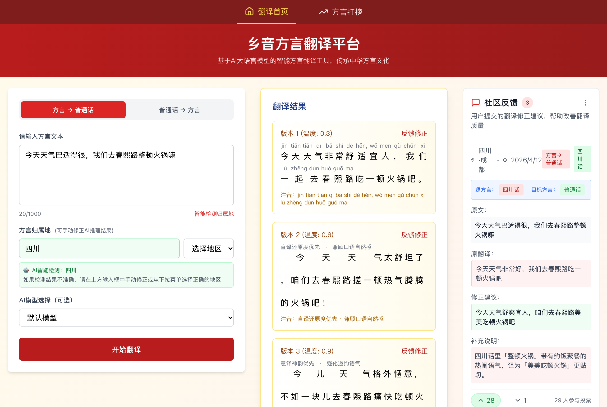
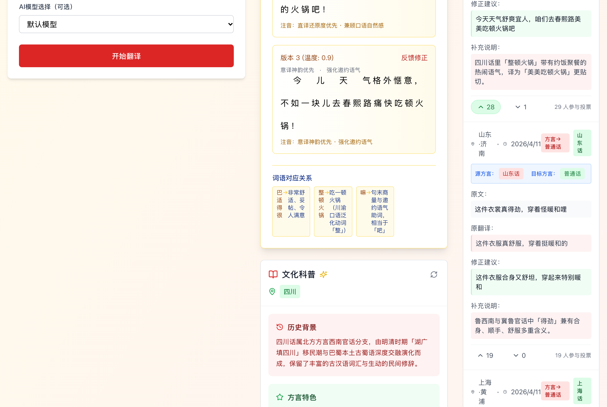

# 乡音 · 方言智能互译与文化科普平台 (Dialect Translate)

<p align="center">
  <b>基于多路大语言模型（GPT-4 / 讯飞星火 / 智谱 GLM）与 Supabase 的汉语方言双向翻译、归属地推理与社区语料众包平台</b><br>
  A Full-Stack Chinese Dialect Translation, Region Detection &amp; Cultural Archiving Web Application
</p>

<p align="center">
  
  
  
  
  
  
</p>

---

## 界面总览

<p align="center">
  
</p>

| 词汇对照、方言文化科普与众包反馈 (`/`) | 方言热度排行榜 (`/ranking`) |
| :---: | :---: |
|  |  |
| 展示方言俚语到普通话的逐词映射、地区方言历史渊源与发音特征，右侧同步呈现社区用户提交的译文修正与投票结果。 | 按统计周期（1 天 / 7 天 / 30 天）聚合各大方言区的累计翻译频次、活跃用户数与高频检索短语。 |

---

## 项目简介

**乡音方言翻译平台（Dialect Translate）** 是面向汉语方言跨地域理解与语料沉淀构建的前后端分离 Web 应用。

由于各大方言区（川渝、粤语、吴语、东北官话、冀鲁官话、闽南语等）存在大量口语俚语与句末语气词，单一通用机器翻译往往丢失语境。本项目通过后端多模型网关集成 **ChatAnywhere (GPT-4)**、**讯飞星火 (Spark)** 与 **智谱清言 (GLM)**，结合多温度采样生成（`temperature = 0.3 / 0.6 / 0.9`）、方言归属地自动识别、结构化文化卡片缓存与社区众包纠错投票，提升方言互译的准确性与可读性。

### 核心功能

1. **方言与普通话双向互译 (`/api/translate` & `/api/translate/stream`)**：
   - **方言 → 普通话**：支持自动推理输入文本的方言归属地（如四川话、山东话、上海话），并行输出严谨直译（`0.3`）、自然口语（`0.6`）与意译润色（`0.9`）三档译文及重点方言词汇映射表。
   - **普通话 → 方言**：支持指定目标方言区，生成地道方言表达并附带罗马音/拼音谐音注音。
2. **方言归属地智能识别 (`/api/dialect/detect`)**：基于方言特征词与句式结构自动判别来源地区及置信度，同时允许用户手动修正并联动刷新文化科普卡片。
3. **地区语言文化科普 (`/api/culture/:region`)**：自动生成并持久化缓存各地区方言的历史渊源、声韵调特征与民俗背景。
4. **社区众包纠错与投票 (`/api/feedback`)**：支持用户针对模型译文提交地道表达修正与补充说明，结合 IP 归属地标识与赞同/反对投票筛选高质量民间语料。
5. **多维热度榜单 (`/ranking`)**：统计各地区方言在不同时间窗口内的翻译调用量、参与人数与高频短语趋势。

---

## 系统架构与目录结构

```text
dialect-translate/
├── api/                            # Express + TypeScript 服务端
│   ├── config/                     # Supabase 数据库连接与多 LLM 渠道配置 (database.ts, llm.ts)
│   ├── routes/                     # 翻译、归属地检测、文化科普、反馈投票与统计路由
│   ├── services/                   # 多模型调度 (llmService.ts)、持久化 (databaseService.ts)、IP 归属地服务
│   └── app.ts                      # Express 中间件、Helmet 安全头与限流配置
├── src/                            # React 18 + Vite + Tailwind CSS 前端
│   ├── components/                 # TranslationInput / TranslationResult / CultureCard / FeedbackBoard
│   ├── hooks/                      # useTranslation / useCulture / useFeedback 状态管理 Hook
│   ├── pages/                      # Home (翻译主界面) 与 DialectRanking (方言打榜页)
│   ├── services/                   # Axios API 客户端封装与 SSE 流式解析
│   └── types/                      # 前后端共享领域类型定义
├── supabase/                       # 数据库迁移 SQL 脚本
└── assets/screenshots/             # 实机运行界面截图
```

---

## 快速开始

### 1. 安装依赖

```bash
git clone https://github.com/Evan-Joseph/dialect-translate.git
cd dialect-translate
npm install
```

### 2. 配置环境变量

复制 `.env.example` 为 `.env`，按需填入至少一个大模型服务商密钥与 Supabase 连接信息：

```bash
cp .env.example .env
```

```ini
# 大语言模型接口配置（任选其一或配置多路备用）
CHATANYWHERE_API_KEY=your_chatanywhere_api_key
CHATANYWHERE_BASE_URL=https://api.chatanywhere.tech/v1

XUNFEI_API_PASSWORD=your_xunfei_api_password
XUNFEI_ENDPOINT=https://spark-api-open.xf-yun.com/v1/chat/completions

ZHIPU_API_KEY=your_zhipu_api_key
ZHIPU_ENDPOINT=https://open.bigmodel.cn/api/paas/v4/chat/completions

# Supabase 数据库配置（用于持久化社区反馈与文化卡片缓存）
SUPABASE_URL=your_supabase_url
SUPABASE_ANON_KEY=your_supabase_anon_key
SUPABASE_SERVICE_KEY=your_supabase_service_key

PORT=3000
NODE_ENV=development
```

### 3. 启动前后端联调

```bash
# 同时启动 Vite 前端 (http://localhost:5173) 与 Express 后端 (http://localhost:3000)
npm run dev
```

### 4. 类型检查与生产构建

```bash
npm run check
npm run build
npm start
```

---

## 开源许可

本项目采用 [MIT License](LICENSE) 开源。
