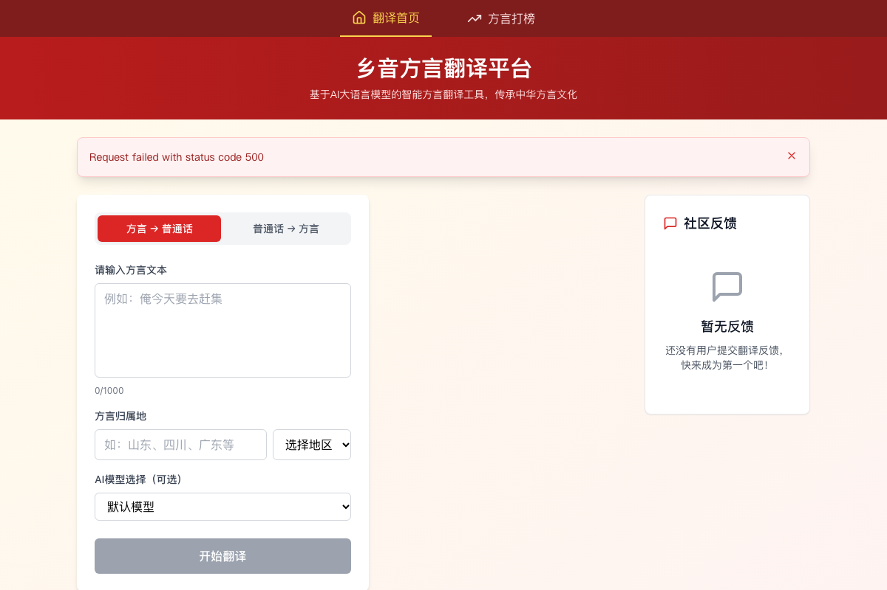
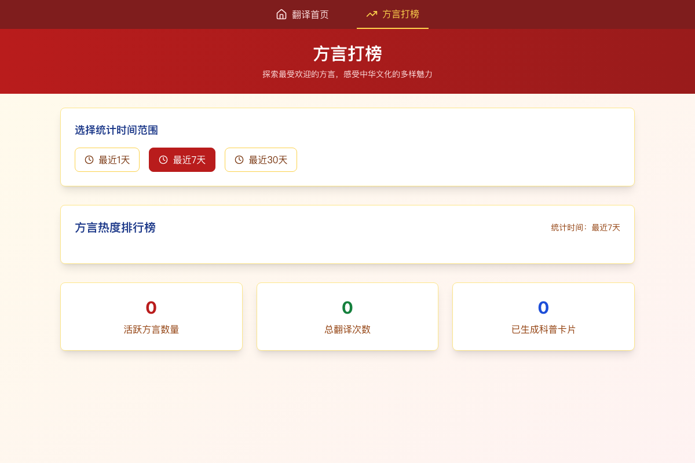
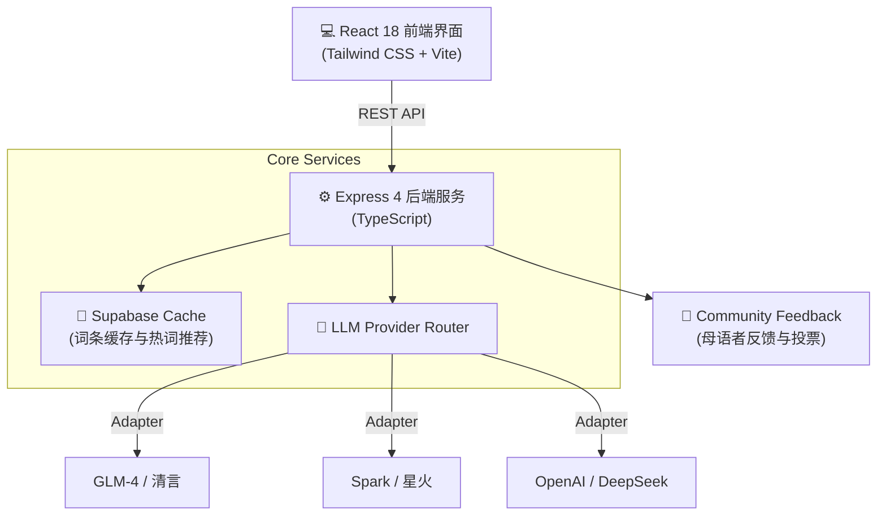

# 🗣️ AI 方言翻译与文化传承平台 · 乡音 (Xiangyin)

<p align="center">
  <b>An AI-Powered Chinese Dialect Translation & Cultural Heritage Platform</b><br>
  基于 React 18 + Express + Supabase 与多大语言模型路由的中华方言双向翻译与文化探索平台
</p>

<p align="center">
  
  
  
  
  
  
  
</p>

<p align="center">
  
</p>

---

## 🖥️ 实机运行截屏 (Live Screenshots)

| 🗣️ 双向翻译与文化科普卡片 (Home) | 📊 方言检索热度与文化榜单 (Ranking) |
| :---: | :---: |
|  |  |
| **智能归属地推断与发音标注**：支持方言/普通话双向转译、置信度温度调节与地域文化背景卡。 | **方言文化热词榜单**：统计粤语、吴语、闽南语、西南官话等各大语系的探索频次与文化词条。 |

---

## 📖 项目简介 (Overview)

**乡音 (Xiangyin)** 是一个旨在保护与传承中华方言多样性的智能化 Web 应用。

项目采用前后端分离架构，前端基于 **React 18 + Tailwind CSS** 提供温润的交互界面，后端基于 **Express + TypeScript** 构建了多大语言模型（LLM）适配层。支持方言到普通话的语义识别与反向地道转译，并集成了文化词源科普与去中心化的社区众包修正机制。

---

## 🛠️ 基于源码的核心功能架构 (Code Grounding)

系统完全由源代码定义，核心模块包含：

1. **双向翻译工作台 (`src/components/TranslationInput/` + `TranslationResult/`)**：
   - **方言 → 普通话**：支持智能识别方言归属地（IP 定位与模型特征判别结合），生成地道普通话语义，保留地方修辞色彩；
   - **普通话 → 方言**：针对粤语、吴语、闽南语、客家话、四川话等指定语系转译，输出带拼音/国际音标（IPA）发音指引。
2. **文化探索卡片 (`src/components/CultureCard.tsx` + `useCulture.ts`)**：
   - 当检测到归属地后，自动从 Supabase 缓存或模型端生成方言历史渊源、典故出处与民俗常识卡片。
3. **社区众包反馈与校验 (`src/components/FeedbackBoard.tsx` + `useFeedback.ts`)**：
   - 母语者可针对机器翻译提交俚语修正建议，支持赞同/反对投票，沉淀高质量微调语料。
4. **方言热度排行榜 (`src/pages/DialectRanking.tsx` + `statsApi.ts`)**：
   - 实时聚合各大方言语系的检索频次、文化贡献度与用户活跃度排行榜。
5. **多供应商适配后端 (`api/services/llmService.ts`)**：
   - 抽象统一适配层，支持智谱 GLM-4、讯飞星火 Spark、OpenAI 协议热插拔与密钥轮转。

---

## 🏛️ 系统架构 (Architecture)



---

## 📦 项目代码结构 (Directory Structure)

```text
dialect-translate/
├── assets/screenshots/      # 从实机运行环境中抓取的真实 UI 截屏
├── api/                     # Express 后端服务源码
│   ├── config/              # 数据库连接与模型参数配置
│   ├── services/            # LLM 适配器、地理位置与缓存服务
│   ├── routes/              # /api/translate, /api/feedback, /api/stats
│   └── server.ts            # 服务入口
├── src/                     # React 前端应用
│   ├── components/          # 翻译输入框、结果展示卡、社区反馈留言板
│   ├── hooks/               # useTranslation, useCulture, useFeedback
│   ├── pages/               # Home (翻译工作台), DialectRanking (方言榜单)
│   └── services/            # 客户端 API 对接服务
└── supabase/                # PostgreSQL 表结构定义与缓存索引
```

---

## 🚀 快速开始 (Quickstart)

### 1. 安装依赖

```bash
git clone https://github.com/Evan-Joseph/dialect-translate.git
cd dialect-translate
pnpm install
```

### 2. 配置环境变量

复制并编辑 `.env`：
```bash
cp .env.example .env
```

配置核心参数：
```env
# 核心大模型配置
ZHIPU_API_KEY=your_zhipu_api_key
ZHIPU_ENDPOINT=https://open.bigmodel.cn/api/paas/v4/chat/completions

# 可选：Supabase 数据库（若留空则走内存 Mock 兜底）
SUPABASE_URL=https://your-project.supabase.co
SUPABASE_ANON_KEY=your_anon_key

PORT=3000
```

### 3. 本地启动

```bash
# 同时启动前端与后端
pnpm run dev
```

- 前端交互界面：`http://localhost:5173`
- 后端 API 端点：`http://localhost:3000/api`

---

## 📄 开源许可证 (License)

本项目采用 [MIT License](LICENSE) 开源。
